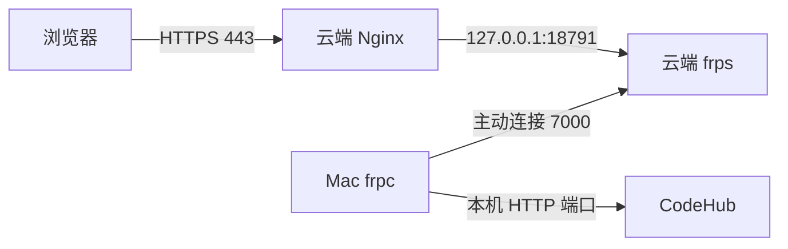

# Mac CodeHub 接入 data.code4101.com

推荐复用现有云服务器入口：Mac 运行 CodeHub 和 FRP 客户端，云端 Nginx 提供 HTTPS 并通过隧道访问 Mac。这样 DNS 和证书可以沿用，Mac 无需公网 IP。

## 当前交接状态

截至 2026-10-12，Windows 的旧 data-manager 服务、专用 FRP 隧道、恢复任务和部署配置已移除；源码和业务数据保留。新 CodeHub 尚未接入。

| 项目 | 当前值 |
| --- | --- |
| 域名及 DNS A 记录 | `data.code4101.com` → `43.161.220.95` |
| 云端 FRP 入口 | `43.161.220.95:7000` |
| 可复用的旧隧道端口 | 云端 `18791`，交接时已无监听 |
| Nginx 配置 | `/etc/nginx/sites-available/data.code4101.com`，已通过 sites-enabled 启用 |
| HTTPS 证书目录 | `/etc/letsencrypt/live/data.code4101.com/` |
| 域名当前响应 | HTTP 和 HTTPS 均返回 `410` |



## 接入步骤

### 1 确认 CodeHub 的生产入口

先在 Mac 本机运行 CodeHub，确定一个同时提供网页和 API 的稳定 HTTP 入口。下文以 `127.0.0.1:3000` 为例，替换为实际端口；启动命令按 CodeHub 项目约定执行。

```bash
curl -I http://127.0.0.1:3000/
```

若前后端使用不同端口，先在 Mac 配置一个统一反向代理入口，再将该入口交给 FRP。将应用的公共 URL、允许的 Host、OAuth 回调等配置为 `https://data.code4101.com`；如框架需要，设置可信代理以正确识别 HTTPS 和安全 Cookie。

### 2 准备云端端口和凭据

#### 给接手 AI 的配置契约

**AI 只阅读本文、`.env.example` 和代码模板，不打开或输出实际 `.env`。** 编写或执行程序时，由程序在运行期加载 `.env` 并使用变量；凭据值不进入 AI 上下文。已有 CodeHub 配置加载器可直接复用。

| 变量 | 类型 | 使用方与含义 |
| --- | --- | --- |
| `FRP_SERVER_ADDR` | 字符串 | frpc 连接的云服务器地址 |
| `FRP_SERVER_PORT` | 整数 | frps 控制连接端口 |
| `FRP_AUTH_TOKEN` | 秘密字符串 | frpc 的 token 认证凭据 |
| `FRP_PROXY_NAME` | 字符串 | 此 Mac 隧道的独立代理名称 |
| `CODEHUB_LOCAL_PORT` | 整数 | Mac 上 CodeHub 统一 HTTP 入口端口 |
| `FRP_REMOTE_PORT` | 整数 | 云端 Nginx 访问的隧道端口 |
| `FRPC_BIN` | 路径或命令名 | Mac 的 frpc 可执行文件，launchd 建议使用绝对路径 |
| `CODEHUB_PUBLIC_URL` | URL | 应用对外地址，映射到 CodeHub 自身公共 URL 配置 |
| `YUN_SSH_HOST` | 字符串 | 云端部署程序连接的 SSH 主机 |
| `YUN_SSH_PORT` | 整数 | SSH 端口 |
| `YUN_SSH_USER` | 字符串 | SSH 用户名 |
| `YUN_SSH_PASSWORD` | 秘密字符串 | 云端部署程序调用 SSH 客户端库时传入的密码 |

程序用配置加载器解析 `.env`，读取以上变量，校验必填项和端口范围，再调用 FRP 或 SSH 接口。缺少配置时只报告变量名；日志只报告连接、认证、校验和部署是否成功，不输出配置对象、环境变量全集、密码、token 或带凭据的命令行。诊断工具输出也须避免泄露凭据；禁止 shell 的 `set -x`、打印 `.env` 或将密码拼进命令参数。

如需修改非敏感配置，由程序按变量名定点更新，返回成功状态，不回显整个文件。SSH 密码只交给客户端库，FRP token 通过环境变量模板交给 frpc。接手 AI 应先完成这层配置接口，再实现部署逻辑。

随附交接包包含 `.env`（实际 FRP 和云端 SSH 凭据）、`frpc.toml`（读取环境变量）、`start-frpc.sh`（加载配置并启动）和本文。真实交接包保存在 Windows 的 `%LOCALAPPDATA%/codeyun/handoffs/codehub-data-domain/`，不进入 Git；仓库中的 [配置模板](../../../scripts/deploy/codehub-domain/) 只有占位符。

将整个交接目录私下传到 Mac 的仓库外部署目录，保留隐藏文件 `.env`，目录权限设置为 `700`、`.env` 为 `600`。`.env` 仍是明文存储，只是与文档、源码隔离，应通过可信私有渠道传输，不贴进聊天、提交到 Git 或发布为公开附件。

Mac 端确认 `CODEHUB_LOCAL_PORT` 和 `FRPC_BIN`，其余连接参数已经填写。`YUN_SSH_*` 供云端配置使用，FRP 启动只需要 `FRP_*` 和本机端口；`CODEHUB_PUBLIC_URL` 是交接参考值，需映射到 CodeHub 自身的配置，脚本不会自动配置应用。核对实际 frps 版本、端口限制及 `18791` 是否仍空闲。CodeYun 环境中取得服务器凭据时，统一通过 `import xlproject.loadenv` 加载。

**启动 Mac 隧道前**，在云端为 `18791` 配置持久防火墙规则：允许 loopback，阻止其他接口直接访问，覆盖 IPv4 和 IPv6。旧部署的专用防火墙服务已删除，接入时需重新配置。公网用户应通过 Nginx 的 HTTPS 入口访问。若 frps 配置了 `allowPorts`，确认包含该端口；共享 frps 的全局监听配置影响其他隧道，调整前核对影响范围。[FRP 服务端参数](https://gofrp.org/en/docs/reference/server-configures/)

### 3 在 Mac 建立 FRP 隧道

安装与云端兼容的 frpc，按 Mac 芯片选择 darwin arm64 或 amd64。frpc 不会自动读取 `.env`；随附脚本先加载变量，再由 FRP 的 `.Envs` 模板渲染配置。先校验，再启动；代理名使用独立名称，避免与其他客户端冲突。[FRP 环境变量模板与校验](https://gofrp.org/en/docs/features/common/configure/)、[客户端参数](https://gofrp.org/en/docs/reference/client-configures/)

```bash
chmod 700 /绝对路径/codehub-data-domain
chmod 600 /绝对路径/codehub-data-domain/.env
sh /绝对路径/codehub-data-domain/start-frpc.sh verify
sh /绝对路径/codehub-data-domain/start-frpc.sh
```

在云服务器验证隧道已到达 CodeHub：

```bash
curl -I -H 'Host: data.code4101.com' http://127.0.0.1:18791/
```

### 4 将云端 Nginx 切换到 CodeHub

备份域名配置。保留已有证书和 HTTP 的 ACME challenge 路径，将 HTTP 的 `location / { return 410; }` 改为跳转 HTTPS；将 HTTPS 的对应 location 改为代理：

```nginx
# HTTP server 中
location / { return 301 https://data.code4101.com$request_uri; }

# HTTPS server 中
location / {
    proxy_pass http://127.0.0.1:18791;
    proxy_http_version 1.1;
    proxy_set_header Host $host;
    proxy_set_header X-Real-IP $remote_addr;
    proxy_set_header X-Forwarded-For $remote_addr;
    proxy_set_header X-Forwarded-Proto $scheme;
}
```

如 CodeHub 使用 WebSocket、SSE 或大文件上传，按实际功能补 Upgrade/Connection、关闭流式响应缓冲、超时及请求体大小配置。修改后运行 `sudo nginx -t`，通过后再执行 `sudo systemctl reload nginx`；校验失败还原备份。检查现有证书续期任务及 ACME 验证路径。

### 5 配置常驻运行并验收

使用 macOS launchd 管理 CodeHub 和随附的 `start-frpc.sh`（通过 `/bin/sh` 启动），配置绝对路径、工作目录、日志、自动启动和退出后恢复。需要登录后启动可用 LaunchAgent，需要开机即服务则用 LaunchDaemon，并指定合适的运行用户。将 Mac 设置为供电时持续运行；睡眠、断网或应用停止都会使网站不可用。

完成以下检查后再视为接入成功：

- 公网访问 `https://data.code4101.com` 展示 CodeHub，证书有效。
- 登录、刷新、API、上传及项目用到的实时连接正常。
- 云端 `127.0.0.1:18791` 可访问，公网直接访问该端口被阻止。
- 重启 Mac 后应用和隧道恢复，原 `https://code4101.com` 主站正常。

## 回退与交接边界

接入失败时，将该域名 Nginx 的 HTTP/HTTPS 普通请求恢复为 `410`，保留 ACME challenge 和证书，停止 Mac 隧道，原主站继续运行。

这套接法只迁移域名的服务目标。旧 data-manager 数据迁入 CodeHub 需要单独设计。若之后改用另一台公网服务器，则更新 DNS 的 A/AAAA 记录，并在新服务器配置 HTTPS 和证书续期；本文的云端 FRP 接法随之退出。
